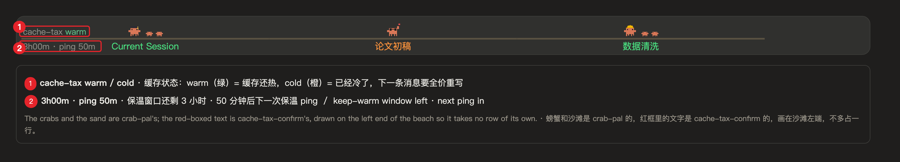
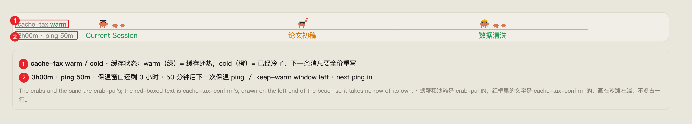

# cache-tax-confirm

[English](README.md)

[karanb192/cache-tax](https://github.com/karanb192/cache-tax) 2.3.1 的修改版（MIT，见 [LICENSE](LICENSE)；原作者 Karan Bansal），用在 Claude 桌面版里。

**要解决的事。** 闲置一段时间后 Claude 的提示缓存会变冷，之后的第一条消息要按全价把整个上下文重写一遍。上游的 cache-tax 会拦下这条消息并告诉你。这个修改版保留拦截，并让你更容易处理：被拦下的消息停在输入框上方的一张卡片后面，卡片上写着价格，有 **Pay and send**（付费发送）和 **Dismiss**（放弃）两个按钮，还会告诉你这条消息值不值得付钱，还是该带着结论去开一个新会话。

## 安装

```text
/plugin install cache-tax-confirm --marketplace GenLI3202/cache-tax-confirm
```

（也可以在命令行 `claude plugin install cache-tax-confirm --marketplace GenLI3202/cache-tax-confirm`；桌面版里用 **+ → Plugins → Add marketplace**。）

**不要和上游的 `cache-tax` 同时安装**：两者都注册 `/keepwarm` 和 `/cache-tax`。

## 和 crab-pal 搭配最好

装了 [crab-pal](https://github.com/GenLI3202/crab-pal) 之后，状态不再单占一行：它以两行小字画在 crab-pal 沙滩的左端（下图红框）。**1** 是缓存状态（`warm` 绿色，`cold` 橙色）；**2** 是保温窗口还剩多久，以及下一次保温 ping 在几分钟后。没装 crab-pal 时，它是输入框上方的一行小字（`/cache-tax display line` 可以挪到输入框下面）。




*图是用 crab-pal 自己的绘制代码，加上本 mod 画状态的同一张小图渲染的，会话名是虚构的。生成脚本在 crab-pal 的 `docs/` 里。*

## 改了什么

- **拦下后可以付费发送。** 缓存冷、守卫设为 `refuse` 时，消息仍然被拦下，但输入框上方的卡片显示价格，点 **Pay and send** 就把原话作为你自己的话重新发出。带附件或 `@` 提及的消息保持上游行为（再发一次就算付费）。
- **付费还是换新会话。** 同时，它判断这条被拦下的消息该不该付钱，并说明理由：
  - 先把会话已有的记录整理成一份简短摘要：被拦下的消息、你最近几条话、上一条回复、子 agent 和其他会话的回传、工作所在的文件（文档优先，并检查它们确实在磁盘上；checkpoint mod 写的 `.claude/checkpoint.md` 权重最大）。
  - 先用规则给出判断，不调用模型；然后让 Haiku 读这份摘要（几千字符，绝不是整个上下文）给出自己的判断，8 秒超时则用规则的结果。一次调用花不到一美分。
  - 「自成一题、结论已经落在文件里」的问题判为**换新会话**；「保持 1:2」「选A」这类任务中途的短指令判为**付费**。
  - 判为换新会话时，它写两份可以直接粘贴到新会话的提示：一份通过 `session-handoff` 技能（用完整会话 id，不会误匹配别的会话），一份自带简报、不需要任何技能。两份末尾都逐字附上被拦下的那条消息，因为被丢掉的消息不在记录里。
  - 判为付费时，多一个 **Pay, send and write a handoff note**，在消息后追加一句让 Claude 写 `.claude/checkpoint.md` 的请求，这次付费同时买到一份交接。
- **显示。** 空闲状态默认是输入框上方一行小字（`cache-tax · warm · 6h00m left · ping in 49m`），`/cache-tax display band|line|off` 切换。被拦下消息的卡片是几行小字：标题、价格、被拦消息（截成一行）、结论和理由、按钮；交接提示各是一个 **Copy** 按钮。
- `/cache-tax preview <消息>`：只展示这条消息的卡片和建议，不拦任何东西。
- 其余（`/keepwarm`、`/cache-tax`）都是上游的。

完整的逐版本说明（confirm.4 到 confirm.15）见[英文 README](README.md)。

## 测试

```bash
claude plugin test .
```
